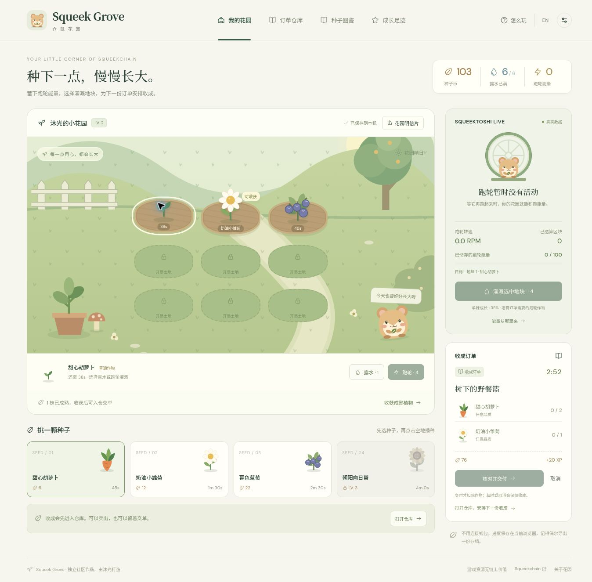

# Squeek Grove · 仓鼠花园

**[在线试玩 / Play now](https://0xmulight.github.io/squeek-grove/)** — 免费打开，无需登录、钱包或签名。

## 中文快速上手

1. 初始有 40 种子币、3 块已开垦土地和 2 株迎新幼苗。选择「甜心胡萝卜」，在第三块空地补种一株。
2. 在「订单仓库」接「树下的野餐篮」：需要 2 个胡萝卜和 1 朵雏菊，确认后限时 3 分钟。
3. 选中生长中的植物，用露水浇灌可增加 25% 成长。成熟后点击「收获成熟植物」，收成先入仓，不会自动出售。
4. 凑齐后查看交付明细并确认，获得 76 种子币和 20 XP。收成也可在仓库单独出售；准备交单的先留着。
5. 有 4 点跑轮能量时，可灌溉指定的一株植物，增加 35% 成长并培育跑轮作物。跑轮专送只收这种品质；普通订单无需跑轮能量。

跑轮能量只在页面处于前台、连续收到有效硬件活动数据时积累。跑轮静止或断线时仍能种植；已经储存的能量可以继续使用。进度保存在当前浏览器，换设备或域名前请在「存档与设置」导出、导入存档。游戏资源没有链上价值。

**v2.0 — wheel irrigation, a harvest warehouse and timed delivery orders.**

An independent bilingual gardening game by Muguang (沐光), designed around Squeektoshi’s real wheel activity. Players allocate stored wheel energy to individual crops, choose what to sell, and plan crop combinations for delivery orders.



## Play

1. Choose one of four seeds and plant it in an empty plot. Three plots are unlocked initially; six more can be purchased with game coins. Two welcome seedlings are included.
2. Irrigate before maturity: one dew adds 25% growth; **four stored wheel energy adds 35% and turns that plant into a wheel-grown crop**. Each type can be used once per plant.
3. Harvest into the warehouse and earn XP. Harvesting no longer pays coins immediately. Sell the crop, or reserve it for a delivery. Wheel-grown crops sell for 1.5× the regular price, rounded down.
4. Accept one of six orders. The deadline starts after confirmation and continues while the page is closed. Standard orders accept either quality; wheel deliveries require wheel-grown crops. Review exact deductions before confirming delivery.
5. Use delivery coins and XP to expand, unlock species and decorate. Expired or cancelled orders keep all plants and inventory.

Crops take 45–240 seconds. Dew refills every 45 seconds, up to six. All standard orders can be grown on three plots within their deadline without wheel energy. Stored energy remains usable during idle periods or disconnections. The game also includes Chinese/English interfaces, keyboard/touch controls, reduced motion, validated save import/export, a seed journal, milestones and PNG postcard export. No wallet, payment or signature is required.

## Background music / 背景音乐

点击右上角音符开启「花园小调」，再次点击暂停；在「存档与设置」调整音量。首次访问默认静音，之后记住开关与音量，点击页面后恢复。切到后台自动暂停。音乐设置单独保存，不改变花园存档。

An original 16-bar, 84 BPM melody is synthesized locally with Web Audio. Use the header music-note button to play/pause, and adjust volume in settings. First visits are silent; remembered playback resumes after a user gesture. Hidden pages pause automatically. No third-party audio files, player embeds or audio downloads are needed.

## Squeekchain integration

**Physical wheel work → stored irrigation energy → a chosen crop → wheel-grown stock → special deliveries.**

- Source: the public [`/v1/status` API](https://api.squeekchain.com/v1/status), schema version 1. [Official API documentation](https://docs.squeekchain.com/developers/api/).
- Visible pages poll every 15 seconds, with a 10-second timeout and at least 60-second backoff after errors. HTTP 429 respects numeric Retry-After seconds.
- Consecutive fresh hardware `measurement.cumulativeWorkUnits` readings within the same installation/counter epoch earn one energy per five new work units. Energy is capped at 100. An interval counts at most 500 units for game balance.
- First connections, visibility resumes, gaps over 90 seconds, stale/non-hardware/fault readings, changed epochs and backwards counters establish a baseline without catch-up rewards. No simulated live-data fallback.
- The latest eight local reading intervals show source counters, counted work, energy added and available settled height. This is local game accounting, not an onchain certificate.
- RPM uses `measurement.rpmMilli / 1000`; settled height uses `builder.anchor.blockHeight`. Sunny garden weather is illustration.
- Ordinary gardening and standard orders remain available when the API or wheel is unavailable. Energy accumulates only while the page is visible and receiving valid consecutive readings.

## Run

Serve `dist/` over HTTP; do not double-click `index.html`. No dependency installation or build is needed.

```sh
python3 -m http.server 8080 --directory dist
```

Open `http://localhost:8080`. Optional Google fonts have system-font fallbacks. All artwork is original SVG/CSS included in the source.

## GitHub upload and hosting

See **[GITHUB_UPLOAD.md](GITHUB_UPLOAD.md)** for Chinese steps. Upload extracted source files, not the ZIP. The included Pages workflow publishes `dist/` after pushes to `main`; enable GitHub Actions as the Pages source first. Relative asset URLs support repository subpaths.

A playable hosted game and a public source repository are separate deliverables. Final Squeekchain direct submission also requires an eligible domain and ownership verification through the current official form. This source contains no issued verification token or IMD job ID.

## Verification

With Node.js 22 or later:

```sh
npm run check
```

The 23 tests cover spending, inventory, exact order deductions, quality requirements, expiry, cancellation, stale confirmations, migration, irrigation and live-data accounting. [VALIDATION.md](VALIDATION.md) records the checks actually performed and their limits.

| File | Purpose |
| --- | --- |
| `dist/engine.mjs` | Game rules, orders, saves and API interpretation |
| `dist/orders.mjs` | Warehouse and order views |
| `dist/app.mjs` | UI, polling, saves and postcard export |
| `dist/art.mjs`, `dist/styles.css` | Original artwork and responsive styling |
| `tests/engine.test.mjs` | Regression tests |
| `.github/workflows/pages.yml` | GitHub Pages deployment |
| `SUBMISSION.md` | Project description and review walkthrough |

## Existing saves and data limits

The app loads `squeek-grove-save-v2` from localStorage, or migrates a valid `squeek-grove-save-v1` if no v2 save exists. The older key is retained. Existing coins, XP, plants, growth boosts, water, energy, collections, goals and decoration remain. Old harvests already paid coins, so they are not duplicated into the new warehouse. Legacy crops start with regular quality. Version 1 JSON backups can also be imported.

Moving from the preview to GitHub Pages or a new domain changes the browser origin: **export the save on the old site, then import it on the new one**. Browser-local saves do not move across domains automatically. Back up before clearing browser data.

This is a single-player game with editable local saves, no cloud saves, global leaderboard, wallet calls, token rewards or official badge issuance. Game resources have no onchain value. Squeek Grove is an independent community project and is not endorsed by Squeekchain. Approval is a separate review.

## Ownership verification

squeekchain-project: bae8bfba-7591-4504-b9b5-6dded38a0ba9

Official Squeekchain Direct submission for project `bae8bfba-7591-4504-b9b5-6dded38a0ba9` on `mulpx.com`. Keep the issued DNS TXT (`_squeekchain`) and the page meta tag in place; they are rechecked daily.
